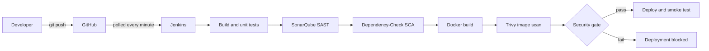

# SecurePipeline architecture

SecurePipeline is a Jenkins pipeline that treats security checks as part of delivery.
Every push is built, tested, scanned three ways, and only deployed if a security gate passes.

```text
Code -> Build -> Test -> SAST -> SCA -> Image build -> Image scan -> Security gate -> Deploy
```

## Components

| Component | Role | Where it runs | Port |
|---|---|---|---|
| GitHub | Source repository and trigger source | github.com | - |
| Jenkins | Orchestrates the pipeline defined in `Jenkinsfile` | Docker container `jenkins` (built from `infra/jenkins/Dockerfile`) | 8082 on the host |
| SonarQube Community Build | Static analysis (SAST) and quality gate | Docker container `sonarqube` | 9000 |
| OWASP Dependency-Check | Scans the app's Python dependencies for known CVEs (SCA) | CLI inside the Jenkins image | - |
| Trivy | Scans the built Docker image for known CVEs | CLI inside the Jenkins image | - |
| Flask app | The deployed workload (`/` and `/health`) | Docker container `securepipeline-demo` | 8081 on the host (5000 in the container) |

Jenkins talks to the host Docker daemon through the mounted Docker socket, so the images it
builds and the containers it starts appear next to Jenkins and SonarQube on the same host.
The infrastructure is started with `docker compose up -d` from `infra/` (see `infra/README.md`).

Pinned tool versions: Jenkins LTS (JDK 21), SonarQube 26.9 Community Build,
Dependency-Check 13.0.0, Trivy 0.74.0, SonarScanner CLI 12.2 (run as a container).

## Pipeline stages

| # | Stage | What it does | Fails the build when |
|---|---|---|---|
| 1 | Checkout | Fetches the commit being built | The repository cannot be fetched |
| 2 | Install Dependencies | Creates a virtualenv and installs `requirements-dev.txt` | `pip` cannot resolve the requirements |
| 3 | Unit Tests | Runs pytest, writes JUnit and coverage XML | Any test fails |
| 4 | SonarQube Analysis | Runs SonarScanner, then fetches the quality gate result into `reports/sonar-gate.json` | The analysis or the status fetch fails |
| 5 | Dependency-Check | Installs runtime requirements into `.deps` and scans them; writes JSON and HTML reports | The scan itself errors (for example the NVD data cannot be updated) |
| 6 | Docker Build | Builds `securepipeline-demo:<build number>` and tags it `latest` | The Docker build fails |
| 7 | Trivy Scan | Scans the image for HIGH and CRITICAL findings that have a fix; writes `reports/trivy.json` | The scan itself errors |
| 8 | Security Gate | Runs `scripts/security_gate.py` over the three reports | Any blocking finding (see below) |
| 9 | Deploy | Replaces the running container with the new image | Docker cannot start the container |
| 10 | Smoke Test | Polls `/health` and expects `Application is healthy` | The app does not become healthy |

Stages 4 to 7 only produce evidence. Only stage 8 decides, and stages 9 and 10 run only if it passes.
Reports from every run are archived by Jenkins under `reports/`.

## The security gate

`scripts/security_gate.py` reads the three reports and exits non-zero (which fails the build and
skips deployment) when any of these is true:

- Dependency-Check reports a vulnerability with a CVSS score of 7.0 or higher
  (threshold set by `--cvss-threshold`; the highest of the CVSS v4, v3 and v2 scores is used,
  and the severity label is used when a finding has no score).
- Trivy reports a HIGH or CRITICAL vulnerability in the image.
- The SonarQube quality gate status is anything other than `OK`.
- A report is missing or unreadable.

The last rule is deliberate: the gate **fails closed**. A scanner that did not run counts as a
failure, not a pass. The decision logic is covered by unit tests in `tests/test_security_gate.py`.

## Credentials and secrets

- The SonarQube token is stored as a Jenkins "Secret text" credential with the ID `sonar-token`
  and injected with `withCredentials`. It never appears in the `Jenkinsfile` or in the logs
  (Jenkins masks it).
- The NVD API key is read from `infra/.env`, which is git-ignored, and passed to the Jenkins
  container as the `NVD_API_KEY` environment variable. Only `infra/.env.example` is committed.
- No other secrets are used. The repository is public and Jenkins pulls it without credentials.

## Trigger

The `Jenkinsfile` polls the repository every minute (`pollSCM`), so a push starts a build without
a public webhook endpoint. Jenkins is configured to build one pipeline at a time, because the
Dependency-Check database and the deployed container are shared state.

## Data kept between builds

Docker named volumes keep the heavy state out of the build workspace: the Dependency-Check NVD
database (`dc_data`) and the Trivy vulnerability database (`trivy_cache`). The first
Dependency-Check run downloads the full NVD data set and can take well over an hour even with an
API key; later runs only apply updates.

## Diagram


